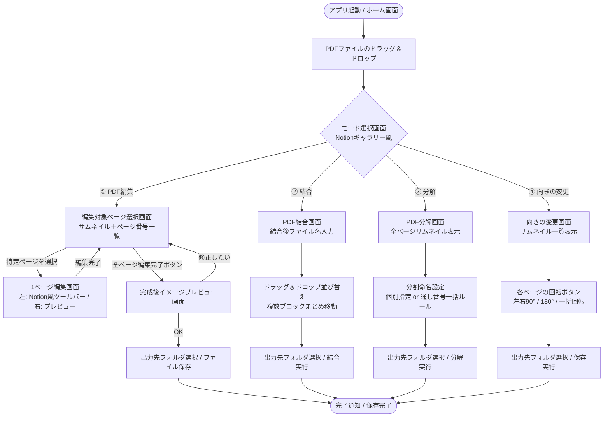

# PDF加工ツール（Notionスタイル） 仕様書 & 実装プラン

## 1. 概要
本ツールは、Notionライクなシンプルで洗練されたUIを備え、ブラウザ上で安全かつ直感的にPDFの「結合」「分解」「向きの変更」「テキスト編集」を行えるデスクトップ向けWebアプリケーションです。

すべての処理はクライアント（ブラウザ内）で完結するため、外部サーバーへのアップロードは一切行われず、経理等の機密文書（請求書・領収書・決算関連書類など）も安全に取り扱うことができます。また、元ファイルは一切上書きせず、すべて新規ファイルとして出力されます。

---

## 2. 画面遷移フロー（Mermaid記法）

---

## 3. 各画面の詳細仕様

### 【共通仕様・Notion風デザインシステム】
- **カラーパレット**: 
  - 背景: Notionライト（`#FFFFFF`）/ サイド・カード背景（`#F7F6F3`）/ ボーダー（`#E9E9E7`）
  - テキスト: 主文字（`#37352F`）/ 補足（`#787774`）
  - アクセント: Notionブルー（`#2383E2`）/ ホバーハイライト（`#EFEFED`）
- **UIコンポーネント**:
  - パンくずリスト（Breadcrumbs: `🏠 ホーム / 📄 請求書_202610.pdf / 🔄 向きの変更`）
  - ページアイコン（絵文字やミニマルアイコン）
  - コールアウトブロック（ヒントや注意書きの表示）
  - スラッシュコマンド風の操作パネル、タグ型バッジ
- **ファイル安全設計**: 元ファイルを書き換えるAPIは使用せず、新規生成したPDF BlobをFile System Access APIまたはダウンロード形式で出力先に保存。

---

### 画面①：ホーム（ドラッグ＆ドロップ & モード選択）
- **機能**:
  - 対象PDFのドラッグ＆ドロップゾーン（複数ファイル同時D&Dにも対応）。
  - ファイル読み込み後、ページ数・ファイルサイズ・メタデータをNotionプロパティ風に表示。
  - 4つのアクションカード（ギャラリー形式）を表示：
    1. **① PDF編集**: テキストの書き換え・追記・削除、墨消し
    2. **② PDF結合**: 複数PDFの順番並び替え、ブロック一括移動、1本化
    3. **③ PDF分解**: ページごとの単票化、連番命名での個別保存
    4. **④ 向きの変更**: 90度・180度の回転、プレビュー確認
- **便利機能提案**:
  - 「最近使ったファイル履歴」をローカルにキャッシュ（パスや名前のみ）
  - 結合の場合は、この画面で複数PDFを一度にまとめてD&D可能。

---

### 画面②：結合（Merge）
- **機能**:
  - 結合後のファイル名入力欄（例: `結合書類_20261016.pdf`）。
  - PDFファイル / ページのサムネイルカードを一覧表示。
  - **D&D並び替え**: カードを掴んでスムーズに並び替え。
  - **複数選択 & まとめて移動**: 
    - チェックボックスまたは `Shift + クリック` / `Ctrl + クリック` で複数カードを選択。
    - 選択した複数ファイルを1つの「ブロック群」としてまとめてドラッグ＆ドロップ移動。
  - 各カードの個別削除ボタン、追加ファイル投入ボタン。
  - 「出力先フォルダを選択して結合」ボタン。

---

### 画面③：分解（Split）
- **機能**:
  - PDFの全ページをサムネイル付きカードで一覧表示。
  - **分割オプション**:
    - 全ページを1ページずつ分解
    - 指定範囲で分解（例: 1-3ページ, 4-10ページ）
    - 【提案機能】**奇数・偶数ページ分解**（スキャナーの両面読取で裏表が別れたPDFの整理に最適）
  - **ファイル名設定機能**:
    - **個別入力モード**: 各ページカード下のテキストボックスで自由にファイル名を変更可能。
    - **一括通し番号ルール設定**:
      - 接頭辞（プレフィックス）: 例 `領収書_`
      - 開始番号: 例 `1`
      - 桁数（ゼロ埋め）: 例 `3桁（001, 002...）`
      - 接尾辞（サフィックス）: 例 `_fix`
      - プレビュー表示: `領収書_001.pdf`, `領収書_002.pdf`...
  - 「出力先フォルダを選択して分解保存」ボタン（選択フォルダ内に全ファイルを一括保存、またはZipダウンロード）。

---

### 画面④：向きの変更（Rotate）
- **機能**:
  - ページのサムネイルをグリッド状に配置。
  - 各ページカードに回転操作ボタンを設置：
    - [↺ 左へ90°]
    - [↻ 右へ90°]（4回押すと360°で元通り）
    - [⇅ 180°反転]（上下逆スキャンの一発解消）
  - 現在の回転角バッジ（0° / 90° / 180° / 270°）を表示。
- **経理業務に役立つ便利機能の提案**:
  - **全ページ一括回転**（「全ページ右90°」「全ページ180°」ボタン）
  - **偶数ページのみ一括回転**（両面スキャナで偶数ページだけ天地逆さまになる現象をワンクリック解決）
  - **横向きページのみ自動検知＆回転**
  - **元に戻す（リセット）**ボタン

---

### 画面⑤：編集（Edit / Annotate）
- **ページ選択画面（ステップ1）**:
  - 全ページのプレビュー一覧とページ番号が表示され、編集したいページをクリック選択。
  - 編集済みページには「編集済」バッジを表示。
  - 「すべての編集を完了してプレビューへ」ボタン。
- **1ページ編集画面（ステップ2）**:
  - **左側（Notion風ツールバー）**:
    - ✏️ **テキスト編集モード**:
      - プレビュー上のテキストをクリックするとサイドバーおよびインラインで即座に編集可能。
      - フォント種類（ゴシック、明朝、等幅）、フォントサイズ（スライダー変更）。
      - **文字のカラー化**: Notionパレット（黒・赤・青・緑・橙・紫）＋カスタムカラー。
      - **太字（Bold）** & **斜め文字（Italic）** のトグル切り替え。
      - **背景マスク**: 元の文字を自動で白塗り隠しして上書き。
    - ➕ **テキスト追加**: 自由な位置をクリックして注釈や金額、日付を追加。
    - 🖍️ **文字のハイライト表示**:
      - プレビュー上でドラッグして蛍光マーカー（イエロー、グリーン、ピンク、ブルー）を引く機能。
    - 🔲 **墨消し・白塗り（リダクション）**:
      - プレビュー上でドラッグして白塗り（文字消去・修正用）または黒塗り（機密情報隠し）を行う機能。
    - 🖼️ **画像の埋め込み**:
      - 企業ロゴ・社印・図表などの画像ファイル（PNG/JPG）をPDF上に挿入・ドラッグ移動・リサイズして埋め込む機能。
  - **右側（インタラクティブプレビュー）**:
    - PDFを高解像度でレンダリング表示。
    - テキスト位置を検知し、ホバーで該当ブロックをハイライト。
    - クリックで編集入力枠が出現。
  - 上部バーに「このページの編集を完了（保存してページ選択へ戻る）」「キャンセル」ボタン。
- **完成後イメージプレビュー画面（ステップ3）**:
  - 編集した全ページを本番レンダリングでプレビュー表示。
  - スライダーやサムネイルで全ページの仕上がりをチェック。
  - 「修正に戻る」ボタン → ページ選択画面に戻り再編集可能。
  - 「出力先フォルダを選択してPDFを生成」ボタン → 新規PDFとして保存。

---

## 4. 技術アーキテクチャ & 採用ライブラリ

1. **フロントエンド構成**:
   - HTML5 / Vanilla CSS（Notionデザインシステム完全再現） / Modern JavaScript (ES Modules)
2. **PDF処理コア**:
   - `pdf-lib`: 高速・軽量なPDF生成、結合、分解、回転、注釈追加、テキスト描画
   - `pdfjs-dist`: PDFの高精細レンダリング、サムネイル作成、テキストレイヤー抽出
3. **ファイル保存**:
   - Modern File System Access API (`showDirectoryPicker`, `showSaveFilePicker`)
   - Windowsのエクスプローラーと同様の出力先フォルダ選択体験を実現。ブラウザが非対応な環境でも自動でフォールバック保存。
4. **セキュリティ**:
   - 100% ローカル完結型（通信なし）。機密情報を含むPDFも安全に加工可能。
